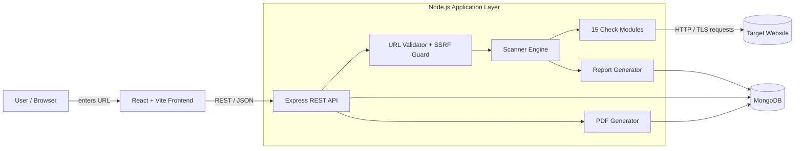
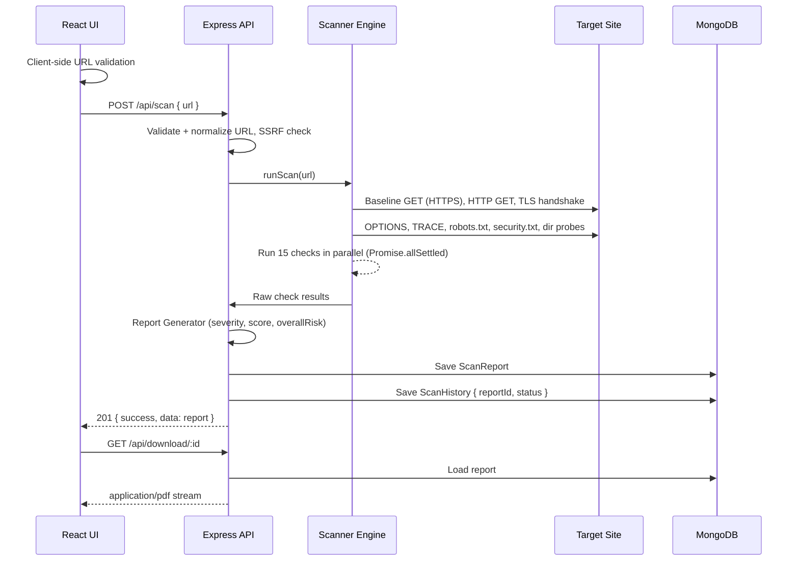
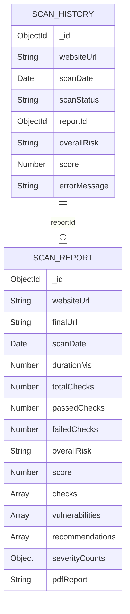

# Website Vulnerability Scanner — Implementation Plan

> A web-based website security assessment and vulnerability detection system.
> **Stack:** React (Vite) · Node.js (v18+) · Express.js · MongoDB (Mongoose) · PDFKit

This document turns the project proposal (`fyp_zeeshan.pdf`) into a concrete, buildable plan: architecture, folder structure, data models, API contracts, the exact logic of all 15 security checks, frontend screens, security hardening, testing, and a day-by-day 4-week schedule.

---

## Table of Contents

1. [Project Summary](#1-project-summary)
2. [Scope](#2-scope)
3. [System Architecture](#3-system-architecture)
4. [Technology Stack & Packages](#4-technology-stack--packages)
5. [Project Directory Structure](#5-project-directory-structure)
6. [Database Design](#6-database-design)
7. [REST API Specification](#7-rest-api-specification)
8. [Scanner Engine Design](#8-scanner-engine-design)
9. [The 15 Security Checks (Detailed)](#9-the-15-security-checks-detailed)
10. [Severity, Scoring & Overall Risk](#10-severity-scoring--overall-risk)
11. [PDF Report Generation](#11-pdf-report-generation)
12. [Frontend Design](#12-frontend-design)
13. [Security of the Scanner Itself](#13-security-of-the-scanner-itself)
14. [Error Handling Strategy](#14-error-handling-strategy)
15. [Configuration & Environment](#15-configuration--environment)
16. [Testing Plan](#16-testing-plan)
17. [Development Timeline (4 Weeks)](#17-development-timeline-4-weeks)
18. [Deployment (Optional)](#18-deployment-optional)
19. [Definition of Done / Acceptance Criteria](#19-definition-of-done--acceptance-criteria)
20. [Future Enhancements](#20-future-enhancements)
21. [References](#21-references)

---

## 1. Project Summary

Users enter a website URL. The backend runs **15 automated, non-intrusive security checks** against the site (HTTPS, TLS certificate, security headers, cookies, CORS, information disclosure, directory listing, HTTP methods, robots.txt, security.txt). It then:

- classifies every finding by severity (**High / Medium / Low / Informational**),
- builds a report with passed and failed checks, evidence, and recommendations,
- stores the report and a history entry in **MongoDB**,
- returns the report to the React UI, and
- lets the user download the report as a **PDF**.

**Target users:** students, developers, and small website owners who need a simple, readable security assessment.

---

## 2. Scope

### 2.1 In Scope

| Area | Deliverable |
|---|---|
| URL scanning | Accept a public URL, validate it, normalize it |
| Vulnerability detection | 15 automated checks (Section 9) |
| Report generation | Passed/failed checks, severity, evidence, recommendations, score |
| Database storage | `ScanReports` + `ScanHistory` collections in MongoDB |
| PDF export | Download any stored report as a PDF |
| Responsive UI | React (Vite) interface for desktop and mobile |
| REST API | Express endpoints for scan, report, history, delete, download, health |

### 2.2 Out of Scope (per proposal)

- Brute-force / authentication attacks, SQLi / XSS exploitation
- DoS / stress testing, password cracking, malware detection
- Full penetration testing or exploitation
- Scanning private / internal networks (**actively blocked**, see Section 13)
- Continuous monitoring, user accounts / RBAC, commercial scanner integrations

> **Design principle:** Every check is **passive or read-only**. The scanner only sends `GET`, `HEAD`, `OPTIONS`, and one `TRACE` probe. It never sends `PUT`/`DELETE` payloads and never tries to exploit anything.

---

## 3. System Architecture

### 3.1 Three-Tier Overview



| Layer | Components |
|---|---|
| Presentation | React.js, React Router, Axios, CSS |
| Application | Node.js, Express.js, Scanner Engine, Report Generator, PDF Generator, REST API |
| Data | MongoDB (local Community Edition or Atlas) via Mongoose |
| External | The user-provided target website |

### 3.2 Scan Request Sequence



---

## 4. Technology Stack & Packages

### 4.1 Frontend (`client/`)

| Package | Purpose |
|---|---|
| `react`, `react-dom` | UI library |
| `vite`, `@vitejs/plugin-react` | Dev server and bundler |
| `react-router-dom` | Routing (`/`, `/report/:id`, `/history`) |
| `axios` | HTTP client for the REST API |
| `react-icons` | Severity and status icons |
| `react-hot-toast` *(optional)* | Toast notifications |
| Plain CSS / CSS Modules | Styling (proposal specifies HTML5/CSS3). CSS variables for theme colors |

### 4.2 Backend (`server/`)

| Package | Purpose |
|---|---|
| `express` | REST API framework |
| `mongoose` | MongoDB ODM |
| `dotenv` | Environment variables |
| `cors` | Restrict the API to the frontend origin |
| `helmet` | Security headers on **our own** API |
| `express-rate-limit` | Throttle scan requests per IP |
| `morgan` | HTTP request logging |
| `axios` | HTTP requests to target sites (redirects handled manually) |
| Node `tls`, `dns`, `net`, `http`, `https` (built-in) | TLS certificate inspection, DNS resolution, SSRF protection |
| `ipaddr.js` | Classify resolved IPs as private / loopback / link-local |
| `set-cookie-parser` | Parse `Set-Cookie` headers for the cookie check |
| `pdfkit` | PDF report generation |
| `nodemon` *(dev)* | Auto-restart in development |
| `jest` / `vitest`, `supertest`, `nock` *(dev)* | Testing |

### 4.3 Tooling

VS Code, Git + GitHub, Postman (API testing), MongoDB Compass, npm, ESLint + Prettier.

### 4.4 System Requirements

Windows 10/11, Linux, or macOS; Node.js v18+; MongoDB 6+ or Atlas; 4 GB RAM minimum (8 GB recommended); a modern browser; an internet connection.

---

## 5. Project Directory Structure

This is a slightly more modular version of the proposal's structure. The proposal's files (`server.js`, `scanner.js`, `database.js`, `pdfGenerator.js`, `models/ScanReport.js`) are all still here. Each security check gets its own file so checks can be added without touching the engine.

```
Website-Vulnerability-Scanner/
├── client/                              # React (Vite) frontend
│   ├── public/
│   │   └── favicon.svg
│   ├── src/
│   │   ├── assets/                      # logo, illustrations
│   │   ├── components/
│   │   │   ├── Navbar.jsx
│   │   │   ├── Footer.jsx
│   │   │   ├── ScanForm.jsx             # URL input + consent checkbox + submit
│   │   │   ├── ScanProgress.jsx         # loading state with check names
│   │   │   ├── Report.jsx               # full report layout
│   │   │   ├── SummaryCards.jsx         # total / passed / failed / score
│   │   │   ├── RiskBadge.jsx            # overall risk pill
│   │   │   ├── SeverityBadge.jsx        # High/Medium/Low/Info pill
│   │   │   ├── CheckCard.jsx            # one expandable check result
│   │   │   ├── SeverityFilter.jsx       # filter checks by severity/status
│   │   │   ├── HistoryTable.jsx
│   │   │   ├── ConfirmDialog.jsx
│   │   │   └── ErrorAlert.jsx
│   │   ├── pages/
│   │   │   ├── Home.jsx                 # scan form + latest result
│   │   │   ├── ReportPage.jsx           # /report/:id
│   │   │   ├── History.jsx              # /history
│   │   │   └── NotFound.jsx
│   │   ├── services/
│   │   │   └── api.js                   # axios instance + API functions
│   │   ├── utils/
│   │   │   ├── validateUrl.js           # client-side URL validation
│   │   │   └── format.js                # dates, severity colors
│   │   ├── App.jsx                      # layout + routes
│   │   ├── main.jsx                     # entry point
│   │   └── index.css                    # global styles + CSS variables
│   ├── .env.example                     # VITE_API_URL
│   ├── index.html
│   ├── package.json
│   └── vite.config.js                   # dev proxy /api -> :5000
│
├── server/                              # Node.js + Express backend
│   ├── checks/                          # one module per security check
│   │   ├── index.js                     # exports ordered array of all checks
│   │   ├── 01-httpsAvailability.js
│   │   ├── 02-sslCertificate.js
│   │   ├── 03-hsts.js
│   │   ├── 04-xContentTypeOptions.js
│   │   ├── 05-xFrameOptions.js
│   │   ├── 06-contentSecurityPolicy.js
│   │   ├── 07-referrerPolicy.js
│   │   ├── 08-permissionsPolicy.js
│   │   ├── 09-cookieSecurity.js
│   │   ├── 10-cors.js
│   │   ├── 11-serverInfoDisclosure.js
│   │   ├── 12-directoryListing.js
│   │   ├── 13-httpMethods.js
│   │   ├── 14-robotsTxt.js
│   │   └── 15-securityTxt.js
│   ├── controllers/
│   │   ├── scanController.js            # POST /api/scan
│   │   ├── reportController.js          # GET /api/report/:id, GET /api/download/:id
│   │   └── historyController.js         # GET /api/history, DELETE /api/history/:id
│   ├── middleware/
│   │   ├── validateScanRequest.js       # body validation + URL normalization
│   │   ├── rateLimiter.js
│   │   ├── validateObjectId.js
│   │   └── errorHandler.js              # central error -> JSON response
│   ├── models/
│   │   ├── ScanReport.js
│   │   └── ScanHistory.js
│   ├── routes/
│   │   └── api.js
│   ├── utils/
│   │   ├── httpClient.js                # safe axios instance (timeouts, size limit, SSRF-safe agent)
│   │   ├── ssrfGuard.js                 # DNS resolve + private IP blocking
│   │   ├── normalizeUrl.js
│   │   ├── AppError.js                  # custom error class
│   │   └── logger.js
│   ├── tests/
│   │   ├── checks/*.test.js
│   │   ├── reportGenerator.test.js
│   │   └── api.test.js
│   ├── scanner.js                       # Scanner Engine: builds context, runs checks
│   ├── reportGenerator.js               # severity, score, overallRisk, recommendations
│   ├── pdfGenerator.js                  # PDFKit report builder
│   ├── database.js                      # Mongoose connection
│   ├── app.js                           # Express app (middleware + routes), exported for tests
│   ├── server.js                        # starts the server, connects DB
│   ├── .env.example
│   └── package.json
│
├── docs/
│   └── postman_collection.json
├── package.json                         # root scripts: run client + server with `concurrently`
├── .gitignore
└── README.md
```

---

## 6. Database Design

Two collections, matching the proposal. `ScanHistory` is the lightweight list shown on the History page. `ScanReports` holds the full report.



### 6.1 `ScanReport` model (`server/models/ScanReport.js`)

```js
const CheckResultSchema = new Schema({
  checkId:        { type: Number, required: true },        // 1..15
  key:            { type: String, required: true },        // e.g. "hsts"
  name:           { type: String, required: true },        // "Strict-Transport-Security"
  category:       { type: String, enum: ['transport', 'headers', 'cookies', 'cors', 'disclosure', 'configuration'] },
  status:         { type: String, enum: ['pass', 'fail', 'warning', 'info', 'error'], required: true },
  severity:       { type: String, enum: ['High', 'Medium', 'Low', 'Informational', 'None'], default: 'None' },
  description:    String,                                  // what the check verifies
  finding:        String,                                  // what we found, in plain English
  evidence:       Schema.Types.Mixed,                      // raw header values, cert dates, etc.
  recommendation: String,
  references:     [String]                                 // MDN / OWASP links
}, { _id: false });

const ScanReportSchema = new Schema({
  websiteUrl:      { type: String, required: true, index: true },  // normalized input URL
  finalUrl:        String,                                         // after redirects
  scanDate:        { type: Date, default: Date.now, index: true },
  durationMs:      Number,
  totalChecks:     { type: Number, default: 15 },
  passedChecks:    Number,
  failedChecks:    Number,
  severityCounts:  { High: Number, Medium: Number, Low: Number, Informational: Number },
  score:           { type: Number, min: 0, max: 100 },
  grade:           { type: String, enum: ['A', 'B', 'C', 'D', 'F'] },
  overallRisk:     { type: String, enum: ['High', 'Medium', 'Low', 'Informational'] },
  checks:          [CheckResultSchema],   // all 15 results (passed + failed)
  vulnerabilities: [CheckResultSchema],   // only failed/warning items (denormalized for quick display)
  recommendations: [String],
  pdfReport:       { type: String, default: null }  // PDFs are generated on demand; field kept for compatibility
}, { timestamps: true });
```

> The proposal lists `vulnerabilities`, `recommendations`, `totalChecks`, `passedChecks`, `failedChecks`, `overallRisk`, and `pdfReport`. These are all included. `checks`, `score`, `grade`, `severityCounts`, `finalUrl`, and `durationMs` are additions that make the UI and PDF richer.

### 6.2 `ScanHistory` model (`server/models/ScanHistory.js`)

```js
const ScanHistorySchema = new Schema({
  websiteUrl:   { type: String, required: true, index: true },
  scanDate:     { type: Date, default: Date.now, index: true },
  scanStatus:   { type: String, enum: ['completed', 'failed'], required: true },
  reportId:     { type: Schema.Types.ObjectId, ref: 'ScanReport', default: null },
  overallRisk:  String,      // copied from report for list display without a join
  score:        Number,
  errorMessage: String       // populated when scanStatus = 'failed'
}, { timestamps: true });
```

### 6.3 Persistence rules

- **Successful scan:** create the `ScanReport`, then the `ScanHistory` with `scanStatus: 'completed'` and its `reportId`.
- **Failed scan** (unreachable host, DNS failure, timeout): create only a `ScanHistory` with `scanStatus: 'failed'` and `errorMessage`.
- **Delete** (`DELETE /api/history/:id`): delete the history entry **and** its linked report.
- **Indexes:** `scanDate` (descending) for history sorting, and `websiteUrl` for search.

---

## 7. REST API Specification

Base URL: `http://localhost:5000/api`

### 7.1 Standard response envelope

```json
// Success
{ "success": true, "data": { ... }, "message": "Scan completed" }

// Error
{ "success": false, "error": { "code": "INVALID_URL", "message": "Please enter a valid http(s) URL." } }
```

### 7.2 Endpoints

| Method | Endpoint | Description | Success | Errors |
|---|---|---|---|---|
| `POST` | `/api/scan` | Validate a URL, run 15 checks, store the report, return it | `201` report | `400` invalid URL, `403` private/blocked host, `422` unreachable target, `429` rate limited |
| `GET` | `/api/report/:id` | Get the full report by `ScanReport` id | `200` report | `400` bad id, `404` not found |
| `GET` | `/api/history` | List scan history (newest first) | `200` list | — |
| `DELETE` | `/api/history/:id` | Delete a history entry and its report | `200` | `400`, `404` |
| `GET` | `/api/download/:id` | Stream the PDF report for a `ScanReport` id | `200 application/pdf` | `400`, `404` |
| `GET` | `/api/health` | Server and DB status | `200` | `503` DB down |

**Query parameters for `GET /api/history`** (small additions to the proposal):
`?page=1&limit=10&search=example.com&risk=High`

### 7.3 Example: `POST /api/scan`

Request:

```json
{ "url": "example.com" }
```

Response (`201`):

```json
{
  "success": true,
  "data": {
    "_id": "6710f0c2a1b2c3d4e5f60789",
    "websiteUrl": "https://example.com/",
    "finalUrl": "https://example.com/",
    "scanDate": "2026-10-15T11:50:00.000Z",
    "durationMs": 4821,
    "totalChecks": 15,
    "passedChecks": 9,
    "failedChecks": 6,
    "severityCounts": { "High": 0, "Medium": 3, "Low": 2, "Informational": 1 },
    "score": 68,
    "grade": "C",
    "overallRisk": "Medium",
    "checks": [
      {
        "checkId": 6,
        "key": "csp",
        "name": "Content-Security-Policy",
        "category": "headers",
        "status": "fail",
        "severity": "Medium",
        "finding": "No Content-Security-Policy header was returned.",
        "evidence": { "header": null },
        "recommendation": "Add a Content-Security-Policy header, starting with default-src 'self' and allowing only trusted sources.",
        "references": ["https://developer.mozilla.org/en-US/docs/Web/HTTP/CSP"]
      }
    ],
    "vulnerabilities": [ "...failed/warning subset of checks..." ],
    "recommendations": [ "Add a Content-Security-Policy header ...", "..." ]
  },
  "message": "Scan completed"
}
```

### 7.4 Example: `GET /api/health`

```json
{ "success": true, "data": { "status": "ok", "uptime": 1234.5, "database": "connected", "version": "1.0.0" } }
```

---

## 8. Scanner Engine Design

### 8.1 Scan context: fetch once, check many times

Most checks only need the headers of the main page. To avoid hitting the target 15+ times, `scanner.js` first builds a shared **scan context**, then passes it to every check:

```js
// scanner.js (outline)
async function runScan(inputUrl) {
  const started = Date.now();
  const target = await normalizeAndGuard(inputUrl);   // URL + SSRF guard

  const context = {
    url: target,                                  // URL object
    hostname: target.hostname,
    httpsResponse: await safeGet(`https://${target.host}${target.pathname}`),  // follows redirects safely
    httpResponse:  await safeGet(`http://${target.host}${target.pathname}`, { followRedirects: false }),
    redirectChain: [...],
    fetch: safeGet,                               // checks can make extra requests (robots.txt, etc.)
    request: safeRequest                          // for OPTIONS / TRACE
  };

  if (!context.httpsResponse.ok && !context.httpResponse.ok) {
    throw new AppError('TARGET_UNREACHABLE', 'The website could not be reached.', 422);
  }

  const settled = await Promise.allSettled(checks.map(c => withTimeout(c.run(context), 10_000)));
  const results = settled.map((r, i) => r.status === 'fulfilled'
    ? r.value
    : errorResult(checks[i], r.reason));          // one failing check never breaks the whole scan

  return { results, finalUrl: context.finalUrl, durationMs: Date.now() - started };
}
```

### 8.2 Check module contract

Every file in `server/checks/` exports the same shape, so adding a 16th check means adding one file:

```js
// checks/04-xContentTypeOptions.js
module.exports = {
  id: 4,
  key: 'xContentTypeOptions',
  name: 'X-Content-Type-Options',
  category: 'headers',
  description: 'Checks whether the site stops browsers from MIME-sniffing responses.',
  references: ['https://developer.mozilla.org/en-US/docs/Web/HTTP/Headers/X-Content-Type-Options'],

  async run(ctx) {
    const value = ctx.mainResponse.headers['x-content-type-options'];
    if (value && value.trim().toLowerCase() === 'nosniff') {
      return pass(this, `Header present: ${value}`, { header: value });
    }
    return fail(this, 'Low',
      value ? `Header has an invalid value: "${value}"` : 'Header is missing.',
      { header: value ?? null },
      'Set "X-Content-Type-Options: nosniff" on all responses.');
  }
};
```

Helpers `pass()`, `fail()`, `warn()`, and `info()` live in `checks/helpers.js` and return the `CheckResultSchema` shape.

### 8.3 Request limits

| Setting | Value |
|---|---|
| Per-request timeout | 8 s |
| Per-check timeout | 10 s |
| Whole-scan timeout | 45 s |
| Max redirects | 5 (each hop re-validated by the SSRF guard) |
| Max response body read | 1 MB (`maxContentLength`) |
| User-Agent | `WVS-Scanner/1.0 (+educational security scanner)` |
| Concurrency | All 15 checks in parallel; directory-listing probes limited to 3 at a time |

---

## 9. The 15 Security Checks (Detailed)

The proposal lists "HTTP Security Headers" (check 3) separately from the specific header checks (4–8). To avoid scoring the same headers twice, **check 3 covers Strict-Transport-Security (HSTS)**, the transport-security header the proposal names under check 3 that isn't covered elsewhere. In the UI, checks 3–8 are grouped under a **"Security Headers"** section, so the proposal's "HTTP Security Headers" item is still shown as one group.

| # | Check | Method | Pass Criteria | Failure Severity |
|---|---|---|---|---|
| 1 | HTTPS Availability | GET `https://host`, GET `http://host` (no redirect follow) | HTTPS reachable **and** HTTP redirects (301/302/307/308) to HTTPS | No HTTPS → **High**; HTTPS available but HTTP not redirected → **Medium** |
| 2 | SSL/TLS Certificate | `tls.connect({ host, port: 443, servername, rejectUnauthorized: false })` → `getPeerCertificate()`, `socket.authorized`, `getProtocol()` | Trusted chain, hostname matches, not expired, >30 days left, TLS ≥ 1.2 | Expired / self-signed / untrusted / hostname mismatch → **High**; expires in <30 days or TLS 1.0/1.1 → **Medium** |
| 3 | Strict-Transport-Security (HSTS) | `strict-transport-security` header on the HTTPS response | Present, `max-age ≥ 15552000` (180 days) | Missing → **Medium**; short `max-age` or no `includeSubDomains` → **Low** |
| 4 | X-Content-Type-Options | header value | Equals `nosniff` | Missing/invalid → **Low** |
| 5 | X-Frame-Options (Clickjacking) | `x-frame-options` **or** CSP `frame-ancestors` | `DENY`/`SAMEORIGIN`, or CSP `frame-ancestors` set | Neither present → **Medium**; deprecated `ALLOW-FROM` → **Low** |
| 6 | Content-Security-Policy | `content-security-policy` header (also notes `-Report-Only`) | Present without `unsafe-inline`/`unsafe-eval`/`*` in `script-src`/`default-src` | Missing → **Medium**; present but weak, or report-only → **Low** |
| 7 | Referrer-Policy | header value | One of `no-referrer`, `same-origin`, `strict-origin`, `strict-origin-when-cross-origin`, `no-referrer-when-downgrade` | Missing → **Low**; `unsafe-url` → **Medium** |
| 8 | Permissions-Policy | `permissions-policy` (or legacy `feature-policy`) | Present and restricts at least one powerful feature (camera, microphone, geolocation) | Missing → **Low** |
| 9 | Cookie Security | Parse every `Set-Cookie` with `set-cookie-parser` | Every cookie has `Secure`, `HttpOnly` (session-like cookies), and `SameSite` | Session/auth-looking cookie without `Secure`/`HttpOnly` → **Medium**; missing `SameSite` → **Low**; `SameSite=None` without `Secure` → **Medium**; no cookies → **Informational (pass)** |
| 10 | CORS Configuration | GET with header `Origin: https://wvs-evil-origin.example` | ACAO absent or a fixed trusted origin | Reflects arbitrary origin **with** `Access-Control-Allow-Credentials: true` → **High**; reflects arbitrary origin → **Medium**; `*` → **Low** (Informational on public static sites) |
| 11 | Server Information Disclosure | `server`, `x-powered-by`, `x-aspnet-version`, `x-aspnetmvc-version`, `x-generator`, `via` | No version numbers / framework names exposed | Version number exposed (e.g. `Apache/2.4.41`, `PHP/7.4.3`) → **Low**; product name only → **Informational** |
| 12 | Directory Listing | GET a few common paths: `/`, `/images/`, `/uploads/`, `/assets/`, `/static/`, `/files/`, `/backup/` | No response body matches listing signatures | Listing found → **Medium** |
| 13 | HTTP Methods | `OPTIONS /` (read `Allow` / `Access-Control-Allow-Methods`) + one `TRACE /` probe | `TRACE` not enabled; `PUT`/`DELETE` not advertised | `TRACE` returns 200 and echoes the request → **Medium**; `PUT`/`DELETE`/`CONNECT` advertised → **Low** |
| 14 | robots.txt Analysis | GET `/robots.txt` | No `Disallow` entries pointing at sensitive paths | Sensitive paths revealed → **Low**; missing file → **Informational** |
| 15 | security.txt | GET `/.well-known/security.txt`, fallback `/security.txt` | File exists with `Contact:` and a non-expired `Expires:` (RFC 9116) | Missing → **Informational**; present but missing `Contact`/`Expires` or expired → **Low** |

### 9.1 Implementation notes per check

**1. HTTPS Availability**
- Request `http://host/` with `maxRedirects: 0` and read `Location`. A pass requires `Location` to start with `https://`.
- If HTTPS fails with a connection error, the site has no HTTPS. All header checks then run against the HTTP response, and the report shows a banner explaining this.

**2. SSL/TLS Certificate Validation**
- Use Node's `tls` module directly. Axios doesn't expose certificate details.
- Evidence: `subject.CN`, `issuer.O`, `valid_from`, `valid_to`, `daysRemaining`, `subjectaltname`, `protocol`, `authorizationError`.
- Map `authorizationError` codes such as `CERT_HAS_EXPIRED`, `DEPTH_ZERO_SELF_SIGNED_CERT`, `SELF_SIGNED_CERT_IN_CHAIN`, `UNABLE_TO_VERIFY_LEAF_SIGNATURE`, and `ERR_TLS_CERT_ALTNAME_INVALID` to readable messages.
- Test against `expired.badssl.com`, `self-signed.badssl.com`, `wrong.host.badssl.com`, and `tls-v1-0.badssl.com:1010`.

**3. HSTS**
- Parse with a regex: `max-age=(\d+)`, `includeSubDomains`, `preload`.
- Only valid on HTTPS responses. If the header only appears on HTTP, browsers ignore it, so flag it.

**5. Clickjacking**
- A pass via CSP `frame-ancestors 'none'|'self'` is equivalent to `X-Frame-Options`. Share the CSP parser with check 6.

**6. CSP**
- Write a tiny parser that splits on `;`, then on whitespace, into a `{ directive: [sources] }` map.
- Weakness flags: `'unsafe-inline'` or `'unsafe-eval'` in `script-src` (falling back to `default-src`), a `*` source, `data:` in `script-src`, and missing `object-src`/`base-uri`.

**9. Cookies**
- Session-like cookie name heuristic: `/sess|sid|auth|token|jwt|login|connect\.sid|PHPSESSID|JSESSIONID|ASP\.NET_SessionId/i`.
- Evidence lists each cookie's **name only** with its flags. Never store cookie values.

**10. CORS**
- Also send one `OPTIONS` preflight with `Access-Control-Request-Method: GET` from the fake origin.
- Also flag a reflected `null` origin (`Origin: null`), which is a common misconfiguration.

**12. Directory Listing**
- Signatures: `<title>Index of /`, `<h1>Index of /`, `Directory listing for /`, `[To Parent Directory]` (IIS), `Parent Directory</a>`.
- Only read the first 64 KB of each response. Treat a 404/403 as a pass for that path.

**13. HTTP Methods**
- The scanner **never** sends real `PUT`/`DELETE` requests. It only reads what `OPTIONS` advertises, so the check stays non-destructive.
- `TRACE` is confirmed enabled if the response status is 200 and the body echoes a custom header (`X-WVS-Trace-Test`).

**14. robots.txt**
- Sensitive keyword list: `admin`, `backup`, `bak`, `config`, `.git`, `.env`, `private`, `secret`, `db`, `database`, `sql`, `dump`, `logs`, `wp-admin`, `phpmyadmin`, `internal`, `staging`, `test`, `api`.
- Evidence: the matched `Disallow` lines (at most 20).

**15. security.txt**
- Parse `Field: value` lines. Validate `Contact` (required), `Expires` (required, must be a future date), and optionally `Encryption`, `Policy`, and `Preferred-Languages`.

### 9.2 Recommendation text

Each check module defines its own `recommendation` string, with snippets where useful:

- **Nginx:** `add_header X-Content-Type-Options "nosniff" always;`
- **Apache:** `Header always set X-Content-Type-Options "nosniff"`
- **Express:** `app.use(helmet())`

These snippets appear in the expandable check card and in the PDF.

---

## 10. Severity, Scoring & Overall Risk

### 10.1 Severity levels (from proposal)

| Severity | Meaning | Color |
|---|---|---|
| High | Critical weakness; fix immediately | `#dc2626` red |
| Medium | Moderate risk if left unresolved | `#ea580c` orange |
| Low | Minor issue / missing best practice | `#ca8a04` yellow |
| Informational | Observation, not a direct vulnerability | `#2563eb` blue |
| None / Pass | Check passed | `#16a34a` green |

### 10.2 Pass / fail counting

- `passedChecks` = checks with `status: pass` (Informational-only results count as passed).
- `failedChecks` = checks with `status: fail | warning`.
- Checks with `status: error` (the check itself crashed or timed out) are shown separately as "Could not be completed". They don't count as passed **or** failed.

### 10.3 Security score (0–100) and grade

```
score = 100 − Σ penalty(finding)
penalty: High = 20, Medium = 10, Low = 4, Informational = 0
score is clamped to the range [0, 100]
```

| Score | Grade |
|---|---|
| 90–100 | A |
| 75–89 | B |
| 60–74 | C |
| 40–59 | D |
| 0–39 | F |

### 10.4 Overall risk (`overallRisk`)

```
if any High finding               → "High"
else if Medium findings ≥ 1       → "Medium"
else if Low findings ≥ 1          → "Low"
else                              → "Informational"
```

This is the "highest severity present" rule. It's simple to explain in the viva and matches the four levels in the proposal.

---

## 11. PDF Report Generation

`server/pdfGenerator.js` uses **PDFKit** and streams the PDF straight to the HTTP response. PDFs are generated **on demand** from the stored report, so no files pile up on disk. The `pdfReport` field stays `null` unless file storage is enabled later.

```js
// GET /api/download/:id
res.setHeader('Content-Type', 'application/pdf');
res.setHeader('Content-Disposition', `attachment; filename="WVS-Report-${hostname}-${date}.pdf"`);
generatePdf(report, res);   // doc.pipe(res); ...; doc.end();
```

### 11.1 PDF layout

1. **Cover / header:** project name, scanned URL, final URL, scan date and time, scan duration.
2. **Executive summary:** overall risk badge, score and grade, totals (checks, passed, failed), severity count table.
3. **Findings table:** `# | Check | Status | Severity` for all 15 checks, color-coded.
4. **Detailed findings:** for each failed or warning check: description, finding, evidence (truncated), and recommendation.
5. **Passed checks:** a short list.
6. **Recommendations summary:** numbered list, ordered by severity.
7. **Footer on every page:** page number, "Generated by Website Vulnerability Scanner", and the disclaimer: *"This automated assessment covers 15 common checks and is not a substitute for a full penetration test."*

---

## 12. Frontend Design

### 12.1 Routes

| Route | Page | Purpose |
|---|---|---|
| `/` | `Home` | Hero, scan form, progress indicator, then the report |
| `/report/:id` | `ReportPage` | Shareable view of a stored report |
| `/history` | `History` | Table of past scans with search, risk filter, pagination, view/download/delete |
| `*` | `NotFound` | 404 page |

### 12.2 Home page flow

1. The user types a URL. `validateUrl()` runs on change and on submit:
   - trims the input, and prepends `https://` if no scheme is given,
   - checks that `new URL()` parses it, the protocol is `http:`/`https:`, the hostname contains a dot (or is a valid IP), and there's no whitespace,
   - shows an inline error message if any rule fails.
2. Consent checkbox: *"I own this website or have permission to scan it."* The Scan button is disabled until it's ticked.
3. On submit, the form and button are disabled and `ScanProgress` shows the 15 check names with a spinner (scans take about 5–15 s).
4. On success, the page navigates to `/report/:id`, or renders `Report` inline. On error, `ErrorAlert` shows the server's message.

### 12.3 Report view components

- **Header:** URL (with a link to the site), scan date, and a **Download PDF** button.
- **SummaryCards:** Score and grade · Overall Risk · Total Checks · Passed · Failed.
- **Severity breakdown bar:** a stacked horizontal bar of High/Medium/Low/Info counts, built with plain CSS. No chart library needed.
- **SeverityFilter:** All · Failed · Passed · High · Medium · Low · Info.
- **Grouped CheckCards:** sections for *Transport Security* (1–3), *Security Headers* (4–8), *Cookies & CORS* (9–10), and *Information Disclosure & Configuration* (11–15). Each card shows a status icon, name, severity badge, and one-line finding. Expanding a card shows the description, evidence (formatted JSON or key/value list), recommendation with a config snippet, and reference links.

### 12.4 History page

| Column | Content |
|---|---|
| Website | URL |
| Date | Formatted local date and time |
| Status | Completed / Failed |
| Risk | `RiskBadge` |
| Score | Number / grade |
| Actions | View · Download PDF · Delete (opens a `ConfirmDialog`) |

The page also has a search box (debounced, filters by URL), a risk dropdown filter, and pagination. If there are no scans yet, an empty state links back to Home.

### 12.5 `services/api.js`

```js
import axios from 'axios';

const api = axios.create({ baseURL: import.meta.env.VITE_API_URL || '/api', timeout: 60_000 });

export const scanWebsite   = (url)        => api.post('/scan', { url }).then(r => r.data.data);
export const getReport     = (id)         => api.get(`/report/${id}`).then(r => r.data.data);
export const getHistory    = (params)     => api.get('/history', { params }).then(r => r.data.data);
export const deleteHistory = (id)         => api.delete(`/history/${id}`);
export const downloadPdf   = (id)         => api.get(`/download/${id}`, { responseType: 'blob' });
export const getHealth     = ()           => api.get('/health');
```

`downloadPdf` turns the blob into an object URL and clicks a temporary `<a download>` link.

### 12.6 UI / UX guidelines

- Mobile-first layout using CSS Grid and Flexbox. Breakpoints at 640 px and 1024 px.
- CSS variables for colors. Optional dark mode via `prefers-color-scheme`.
- Accessible markup: form labels, `aria-live` on the progress and error areas, keyboard-operable expandable cards, and severity shown as both text and color (never color only).

---

## 13. Security of the Scanner Itself

A scanner that fetches any URL a user types is a classic **SSRF (Server-Side Request Forgery)** risk. The proposal already puts private networks out of scope. This section describes how that is enforced.

### 13.1 SSRF guard (`utils/ssrfGuard.js`)

1. Allow only `http:` and `https:` protocols. Reject `file:`, `ftp:`, `gopher:`, `data:`, and so on.
2. Reject URLs containing credentials (`user:pass@host`).
3. Allow ports 80, 443, and (optionally) 8080/8443 only.
4. Resolve the hostname with `dns.lookup(host, { all: true })` and reject the request if **any** resolved address is:
   - loopback (`127.0.0.0/8`, `::1`), private (`10/8`, `172.16/12`, `192.168/16`, `fc00::/7`),
   - link-local (`169.254/16`, which includes the cloud metadata address `169.254.169.254`, and `fe80::/10`),
   - unspecified, broadcast, multicast, or carrier-grade NAT (`100.64/10`, `0.0.0.0/8`).
   Classification uses `ipaddr.js` `range()`, allowing only `unicast`.
5. Reject hostnames such as `localhost`, `*.local`, and `*.internal`.
6. **Defend against DNS rebinding:** the HTTP and HTTPS agents use a custom `lookup` function that re-validates the IP **at connect time**. This covers the actual socket connection, not just the initial pre-check.
7. Follow redirects **manually** (`maxRedirects: 0`), running the guard on each `Location` hop.

### 13.2 API hardening

| Control | Implementation |
|---|---|
| Rate limiting | `express-rate-limit`: 10 scans per 15 min per IP on `/api/scan`; 100 req/15 min on other routes |
| CORS | Allow only `CLIENT_ORIGIN` from `.env` |
| Security headers | `helmet()` on our own API (the scanner should pass its own checks) |
| Body size | `express.json({ limit: '10kb' })` |
| Input validation | URL length ≤ 2048, required string, trimmed |
| ObjectId validation | `mongoose.isValidObjectId()` middleware returns `400` |
| NoSQL injection | Only typed values reach queries; search uses an escaped regex |
| Secrets | `.env` is gitignored; `.env.example` is committed |
| Error leakage | Stack traces only when `NODE_ENV=development` |
| Logging | `morgan` access log; no cookie values or response bodies logged |

### 13.3 Ethical use

- Consent checkbox in the UI, plus a disclaimer in the README and the PDF.
- Identifiable User-Agent string.
- Only non-intrusive requests (Section 2.2).

---

## 14. Error Handling Strategy

| Scenario | Where caught | HTTP | Code | User message |
|---|---|---|---|---|
| Empty/malformed URL | Client + `validateScanRequest` | 400 | `INVALID_URL` | "Please enter a valid website URL, e.g. https://example.com" |
| Private/internal host | `ssrfGuard` | 403 | `BLOCKED_HOST` | "Scanning private or internal addresses is not allowed." |
| DNS lookup fails | `ssrfGuard` | 422 | `DNS_FAILURE` | "The domain could not be resolved. Check the spelling." |
| Target unreachable / timeout | `scanner.js` | 422 | `TARGET_UNREACHABLE` | "The website did not respond within the time limit." |
| A single check throws | `Promise.allSettled` | — | — | That check shows status `error`; the rest of the report is still returned |
| Invalid report id | `validateObjectId` | 400 | `INVALID_ID` | "Invalid report id." |
| Report not found | controller | 404 | `NOT_FOUND` | "Report not found." |
| Too many scans | rate limiter | 429 | `RATE_LIMITED` | "Too many scans. Please wait a few minutes." |
| DB disconnected | `errorHandler` / health | 503 | `DB_UNAVAILABLE` | "Service temporarily unavailable." |
| Unknown error | `errorHandler` | 500 | `INTERNAL_ERROR` | "Something went wrong. Please try again." |

All errors are thrown as `AppError(code, message, status)` and converted to the standard envelope in `middleware/errorHandler.js`. Async controllers are wrapped with an `asyncHandler` so rejected promises reach the error handler.

---

## 15. Configuration & Environment

### 15.1 `server/.env.example`

```env
PORT=5000
NODE_ENV=development
MONGODB_URI=mongodb://127.0.0.1:27017/wvs
CLIENT_ORIGIN=http://localhost:5173
SCAN_RATE_LIMIT_MAX=10
SCAN_RATE_LIMIT_WINDOW_MIN=15
REQUEST_TIMEOUT_MS=8000
SCAN_TIMEOUT_MS=45000
ALLOWED_PORTS=80,443,8080,8443
```

### 15.2 `client/.env.example`

```env
VITE_API_URL=http://localhost:5000/api
```

### 15.3 `client/vite.config.js` dev proxy

```js
export default defineConfig({
  plugins: [react()],
  server: { proxy: { '/api': 'http://localhost:5000' } }
});
```

### 15.4 Root scripts (`package.json`)

```json
{
  "scripts": {
    "install:all": "npm install --prefix server && npm install --prefix client",
    "dev": "concurrently -n server,client -c blue,green \"npm run dev --prefix server\" \"npm run dev --prefix client\"",
    "test": "npm test --prefix server",
    "build": "npm run build --prefix client"
  }
}
```

---

## 16. Testing Plan

### 16.1 Backend unit tests (Jest/Vitest + `nock`)

- **Each check module:** feed mocked responses and assert `status`/`severity`. Examples:
  - `x-content-type-options: nosniff` → pass; missing → fail/Low.
  - CSP containing `'unsafe-inline'` in `script-src` → warning/Low.
  - CORS reflecting the origin with credentials → fail/High.
  - Cookie `sessionid` without `HttpOnly` → fail/Medium.
- **`reportGenerator`:** score math, grade boundaries, and `overallRisk` rules.
- **`ssrfGuard`:** blocks `127.0.0.1`, `localhost`, `10.0.0.5`, `169.254.169.254`, `[::1]`, `0.0.0.0`, decimal IP `2130706433`, and `file:///etc/passwd`; allows `example.com`.
- **`normalizeUrl`:** `example.com` → `https://example.com/`; trims whitespace; rejects `javascript:`.

### 16.2 API integration tests (`supertest` + test database / `mongodb-memory-server`)

- `POST /api/scan` with valid (mocked) and invalid URLs.
- `GET /api/report/:id`: found, not found, bad id.
- `GET /api/history`: ordering and pagination.
- `DELETE /api/history/:id` removes both documents.
- `GET /api/download/:id` returns `application/pdf` and a body starting with `%PDF`.
- `GET /api/health`.

### 16.3 Real-world validation targets (manual)

| Target | Expected |
|---|---|
| `https://expired.badssl.com` | Check 2 High (expired) |
| `https://self-signed.badssl.com` | Check 2 High (self-signed) |
| `https://wrong.host.badssl.com` | Check 2 High (hostname mismatch) |
| `http://http.badssl.com` | Check 1 High/Medium |
| `https://github.com` | Mostly passes (strong headers) |
| `https://example.com` | Missing most security headers |
| `https://securityheaders.com` | Compare our header results with theirs |
| `http://localhost`, `http://192.168.1.1` | Blocked with 403 |

### 16.4 Frontend tests

- Vitest + React Testing Library: `validateUrl` cases, `ScanForm` disabled states, `CheckCard` expand/collapse, `SeverityBadge` rendering.
- Manual responsive testing in Chrome DevTools at 375 px, 768 px, and 1440 px, and in Chrome, Firefox, and Edge.

### 16.5 API testing with Postman

Export a collection with all 6 endpoints and example bodies to `docs/postman_collection.json`.

---

## 17. Development Timeline (4 Weeks)

The proposal's four phases, broken down by day.

### Week 1: Requirements, Design & Setup

| Day | Tasks | Output |
|---|---|---|
| 1 | Study HTTP security headers (MDN), OWASP WSTG configuration testing, RFC 6797/6265/9116 | Notes on every check's pass/fail rule |
| 2 | Finalize architecture, sequence diagram, data model | This plan, diagrams |
| 3 | Create the repo, `client/` (Vite React) and `server/` (Express), ESLint/Prettier, `.gitignore`, root scripts | Both apps run with "hello world" |
| 4 | `database.js`, Mongoose models, `/api/health`, error handler, `AppError` | Health endpoint shows DB connected |
| 5 | UI wireframes (Home, Report, History); CSS variables and layout; Navbar/Footer | Static pages with routing |
| 6–7 | `normalizeUrl`, `ssrfGuard`, `httpClient` with safe agents, plus unit tests | Safe request layer done and tested |

**Milestone 1:** project planning and system design complete, skeleton running.

### Week 2: Frontend & Backend Core

| Day | Tasks | Output |
|---|---|---|
| 8 | `ScanForm` + `validateUrl` + consent checkbox | Working form with validation |
| 9 | `scanner.js` engine (context, `Promise.allSettled`, timeouts), check helpers, `checks/index.js` | Engine runs with stub checks |
| 10 | `POST /api/scan` controller + `validateScanRequest` + rate limiter | End-to-end scan returns stub report |
| 11 | `reportGenerator.js` (counts, score, grade, overallRisk, recommendations) + tests | Real report structure |
| 12 | `Report`, `SummaryCards`, `CheckCard`, `SeverityBadge`, `RiskBadge`, `ScanProgress` | Report renders from API data |
| 13 | `GET /api/report/:id`, `ReportPage` | Shareable report URL |
| 14 | Buffer / catch-up / code review | — |

**Milestone 2:** React frontend and Express backend developed and connected.

### Week 3: 15 Security Checks, MongoDB & PDF

| Day | Tasks | Output |
|---|---|---|
| 15 | Checks 1 (HTTPS) and 2 (TLS certificate) + tests with badssl.com | Transport checks done |
| 16 | Checks 3–8 (HSTS, XCTO, XFO, CSP, Referrer, Permissions) + CSP parser | Header checks done |
| 17 | Checks 9 (Cookies) and 10 (CORS) | Cookie and CORS checks done |
| 18 | Checks 11 (Server info), 12 (Directory listing), 13 (HTTP methods) | Disclosure/config checks done |
| 19 | Checks 14 (robots.txt) and 15 (security.txt); write all recommendation texts and snippets | **All 15 checks complete** |
| 20 | Save to MongoDB (`ScanReport` + `ScanHistory`), failed-scan handling; `GET/DELETE /api/history` | Persistence complete |
| 21 | `pdfGenerator.js` + `GET /api/download/:id` + frontend download button | **PDF export works** |

**Milestone 3:** all 15 checks implemented; MongoDB integration and PDF generation complete.

### Week 4: Integration, Testing, Docs & Submission

| Day | Tasks | Output |
|---|---|---|
| 22 | `History` page: table, search, filter, pagination, delete with confirm | History feature complete |
| 23 | Severity filter, grouped sections, empty/loading/error states, responsive polish | UI complete |
| 24 | Integration tests (supertest), frontend tests, Postman collection | Test suite passes |
| 25 | Manual testing against the validation targets (Section 16.3); fix bugs | Bug list closed |
| 26 | Run the scanner against our own API to make sure it passes its own checks; performance tuning | Self-scan grade A/B |
| 27 | README (setup, screenshots, API docs), final report chapters, diagrams | Documentation |
| 28 | Demo rehearsal, optional deployment, final submission | **Final project submission** |

**Milestone 4:** system testing, debugging, documentation, and final submission done.

---

## 18. Deployment (Optional)

| Component | Option |
|---|---|
| Database | MongoDB Atlas free tier (M0). Allow-list the backend's IP |
| Backend | Render / Railway / Fly.io (Node 18+). Set env vars from `.env.example` |
| Frontend | Vercel / Netlify. Set `VITE_API_URL` to the deployed backend URL |
| CORS | Set `CLIENT_ORIGIN` to the deployed frontend URL |

If deployed behind a proxy, set `app.set('trust proxy', 1)` so rate limiting sees the real client IP.

---

## 19. Definition of Done / Acceptance Criteria

- [ ] The user can enter a URL (with or without a scheme) and start a scan from the Home page.
- [ ] Invalid URLs are rejected on the client and the server with clear messages.
- [ ] Private, loopback, and metadata addresses are blocked (403).
- [ ] All **15 checks** run and each returns status, severity, finding, evidence, and recommendation.
- [ ] One check failing internally doesn't break the scan.
- [ ] The report shows total, passed, and failed counts, the severity breakdown, the score/grade, and the overall risk.
- [ ] Every completed scan is stored in `ScanReports` and `ScanHistory`; failed scans are stored in `ScanHistory` with an error.
- [ ] The History page lists past scans; users can view, download, and delete them.
- [ ] The PDF downloads and contains the summary, findings table, details, and recommendations.
- [ ] All 6 REST endpoints work as specified and are documented in Postman.
- [ ] The UI is responsive at 375 px, 768 px, and 1440 px.
- [ ] A typical scan finishes in under 20 s.
- [ ] Backend unit and integration tests pass.
- [ ] The README covers setup, environment variables, scripts, the API, screenshots, and the disclaimer.

---

## 20. Future Enhancements

From the proposal, plus how each would fit this architecture:

| Enhancement | Where it fits |
|---|---|
| User authentication | Add a `User` model + JWT middleware; add `userId` to `ScanHistory` |
| Scheduled scans | `node-cron` or BullMQ job queue calling `runScan()` |
| Email notifications | Nodemailer after scheduled scans |
| Dashboard analytics | MongoDB aggregation endpoints + Recharts on the frontend |
| More checks / OWASP Top 10 coverage | Add files to `server/checks/`; the engine picks them up automatically |
| Multi-website scanning | Batch endpoint + job queue + comparison view |
| CSV / Excel export | `json2csv`, `exceljs` alongside `pdfGenerator.js` |
| Cloud deployment | Section 18 |
| AI-based recommendations | Send the findings JSON to an LLM API for prioritized, site-specific advice |
| Async scans with live progress | `POST /api/scan` returns `202` + job id; progress over Server-Sent Events/WebSocket |

---

## 21. References

1. MDN: HTTP Headers: https://developer.mozilla.org/en-US/docs/Web/HTTP/Headers
2. OWASP Web Security Testing Guide: https://owasp.org/www-project-web-security-testing-guide/
3. OWASP Top 10: https://owasp.org/www-project-top-ten/
4. OWASP Secure Headers Project: https://owasp.org/www-project-secure-headers/
5. OWASP SSRF Prevention Cheat Sheet: https://cheatsheetseries.owasp.org/cheatsheets/Server_Side_Request_Forgery_Prevention_Cheat_Sheet.html
6. Node.js docs (`tls`, `dns`, `http`): https://nodejs.org/docs/latest/api/
7. Express.js: https://expressjs.com/
8. React: https://react.dev/ · Vite: https://vitejs.dev/
9. MongoDB: https://www.mongodb.com/docs/ · Mongoose: https://mongoosejs.com/docs/
10. PDFKit: https://pdfkit.org/
11. SSL Labs Server Test: https://www.ssllabs.com/ssltest/
12. badssl.com (TLS test targets): https://badssl.com/
13. RFC 9110: HTTP Semantics · RFC 6797: HSTS · RFC 6265: Cookies · RFC 9116: security.txt
